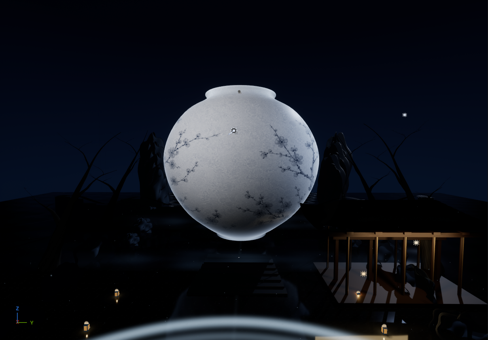

<div align="center">

# 빛의 대한민국 : 달빛에서 네온까지

**Unreal Engine 5로 만든 한국형 이머시브 미디어아트 전시 — ZONE 01 「달빛의 한국」**




[▶ 60초 오프닝 영상 보기 (MP4)](https://jeonghun267.github.io/assets/media/lightofkorea-opening.mp4)

</div>

---

## 프로젝트 소개

달빛 아래의 한국에서 네온의 현대 도시까지, 한국의 빛을 다섯 개 공간(ZONE)으로 보여 주는 미디어아트 전시를 목표로 하는 개인 학습 프로젝트입니다.
지금은 첫 공간인 **ZONE 01 「달빛의 한국」의 60초 오프닝**을 완성했습니다. 어둠 속에서 거대한 달항아리가 떠오르고, 바닥에 퍼지는 빛의 파동을 따라 빛의 숲과 한옥이 차례로 깨어납니다.

- **형태**: 개인 프로젝트
- **엔진**: Unreal Engine 5.7 (5.7.4에서 제작·검증)
- **특징**: 마켓플레이스 에셋 없이 재질·메시·이펙트를 직접 제작

## 연출 구성 (60초)

| 시간 | 연출 |
|---|---|
| 1–5초 | 어둠 속에서 달항아리 윤곽만 은은하게 발광 |
| 5–12초 | 유약 표면 색과 조명이 서서히 등장 |
| 10–15초 | 먹 매화 문양이 표면을 따라 번져 나옴 |
| 15–22초 | 달무리와 주변 입자가 깨어남 |
| 22초 | 바닥 중앙에서 첫 번째 빛의 파동(Ripple) 시작 |
| 27–38초 | 파동이 지나가는 순서대로 앞쪽 나무 → 뒤쪽 나무 → 한옥 → 입자가 켜짐 |
| 46초 이후 | 더 약한 두 번째 파동, 마지막 완성 구도 유지 |

## 주요 구현

### 1. 달항아리 표면
- 유약 질감과 먹 매화 문양을 하나의 텍스처 아틀라스로 만들고, 월드 좌표 투영으로 모델에 입혔습니다.
- 표면 전체를 발광시키지 않고 윤곽 Fresnel 발광만 남겨 도자기 질감을 살렸습니다.
- 달항아리 전용 조명을 Lighting Channel로 분리해, 항아리만 밝히고 주변 전시 공간은 어둡게 유지했습니다.

### 2. 파동 하나로 공간 전체를 깨우기
- 바닥 중앙에서 초속 440cm로 퍼지는 파면을 기준으로, 나무·한옥·조명 재질이 **같은 원점과 속도**로 반응합니다.
- 새로운 Tick 로직 없이 Material Parameter Collection 값 하나를 Sequencer에서 움직여 모든 반응을 재현합니다.
- 재생이 끝나도 마지막 구도가 유지되도록 MPC·조명·카메라 섹션에 Keep State를 적용했습니다.

### 3. 빛의 숲과 공간
- 나무 인스턴스, 가지 끝의 부드러운 빛, 꽃잎 군집을 Niagara와 재질로 구성했습니다.
- 반사 바닥, 낮은 안개, 한옥 실루엣으로 깊이감을 만들었습니다.

### 4. Python으로 제작·검증 자동화
- Unreal Editor Python 스크립트로 장면 생성, 재질 보정, 렌더, 검증(같은 스크립트를 다시 돌려도 결과가 같은지 확인)을 자동화했습니다.
- 수정 후에는 맵을 새 프로세스에서 다시 불러와 확인하고, 50–58초 구간 240프레임을 렌더해 결과를 검토했습니다.

## 기술 스택

| 분류 | 사용 기술 |
|---|---|
| 엔진 | Unreal Engine 5.7, Lumen, Virtual Shadow Maps, DX12 |
| 연출 | Sequencer, Material Parameter Collection |
| 그래픽 | Material(마스터·인스턴스), Niagara, Lighting Channels |
| 자동화 | Unreal Editor Python, Movie Render Pipeline |

## 실행 방법

1. Unreal Engine **5.7**을 설치하고 `LightOfKorea.uproject`를 엽니다.
2. `/Game/LOK/Maps/Zone01/LV_Zone01_Moonlight` 맵을 엽니다. (기본 시작 맵 `Main`에는 전시가 없습니다.)
3. **Play**를 누르면 전시 카메라로 60초 오프닝이 재생됩니다. 처음에는 어둡게 시작합니다.
4. 완성 구도는 `LS_Zone01_Opening`의 55초(1650프레임)에서 볼 수 있습니다.

저장된 장면을 바로 감상할 수 있으며, 제작 스크립트를 다시 실행할 필요는 없습니다.

## 프로젝트 구조

```
Content/LOK/      # 맵, Blueprint, Material, Niagara, 메시, Sequencer
Content/Python/   # 장면 생성·보정·렌더·검증 스크립트
SourceArt/        # 달항아리 텍스처 원본
Tools/            # 실행·진단 도구
Docs/             # 설계, 연출 타이밍, 작업 기록
```

## 현재 범위와 다음 단계

- **완료**: ZONE 01 60초 오프닝
- **예정**: ZONE 02–05, 사운드 믹싱, 센서 입력, 전시장 다면 프로젝션(nDisplay)·조명 제어(DMX), 실제 장비에서의 성능 검증

## 문서

| 문서 | 내용 |
|---|---|
| [Docs/ZONE01_PLAN.md](Docs/ZONE01_PLAN.md) | 공간·시각 방향 설계 |
| [Docs/ZONE01_TIMING.md](Docs/ZONE01_TIMING.md) | 단계별 연출 타이밍과 달항아리 표면 제작 기록 |
| [Docs/ZONE01_RUN.md](Docs/ZONE01_RUN.md) | 실행 안내 |
| [Docs/WORK_STATUS.md](Docs/WORK_STATUS.md) | 제작·검증 이력 |

## 개발 흐름

- `jeonghun` 브랜치에서 작업하고, 빌드·실행으로 에러가 없는지 확인한 뒤 `main`에 머지합니다.
- `main`은 항상 실행 가능한 상태로 유지합니다.
