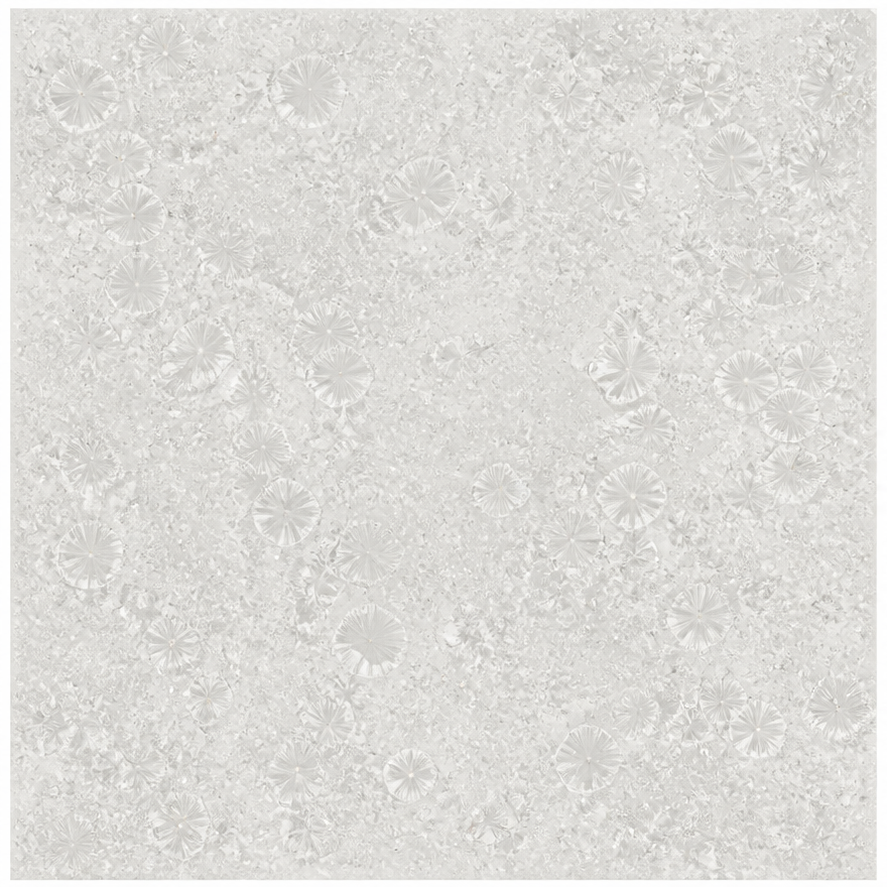
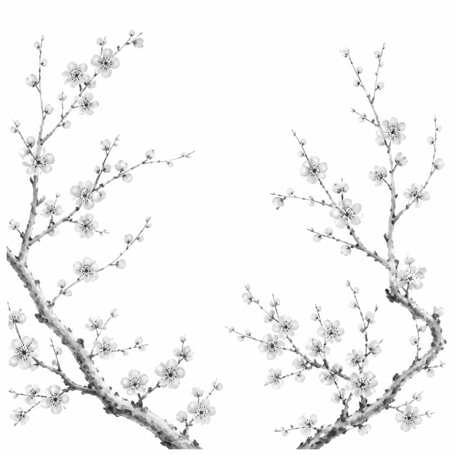

# 달항아리 표면 이미지

제작한 합본 텍스처를 좌우로 나눈 원본 해상도 PNG입니다. 각 이미지는 887×887 픽셀이며, 크기 변경이나 색상 보정 없이 분리했습니다.

## 유약 질감

## 먹 매화 문양

Unreal 재질은 기존 [합본 텍스처](../../Content/LOK/Textures/Source/T_MoonJar_GlazeInk_Atlas.png)를 계속 사용합니다. 두 PNG를 좌우로 다시 붙였을 때 합본 원본과 모든 픽셀이 일치하는 것을 확인했습니다.

생성 도구와 프롬프트: [표면 제작 기록](../../Docs/ZONE01_TIMING.md)
